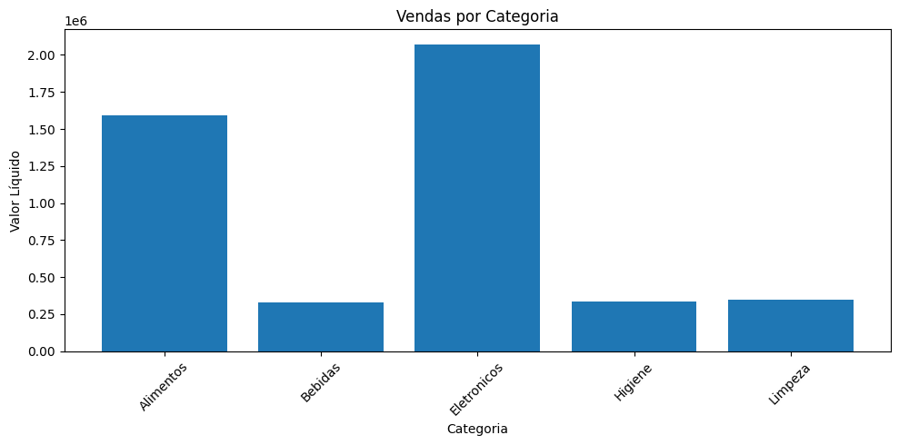
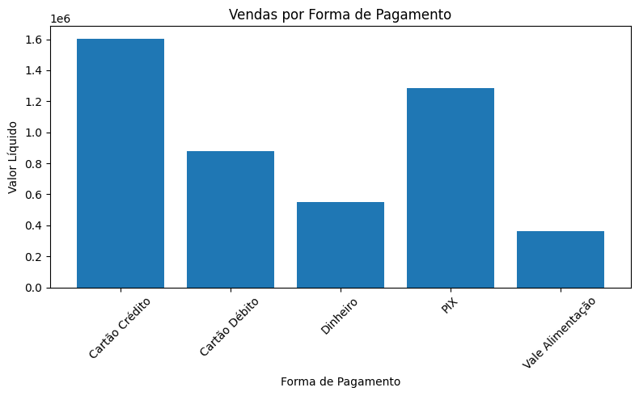
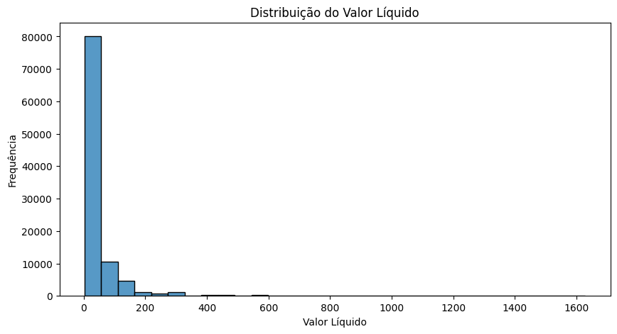
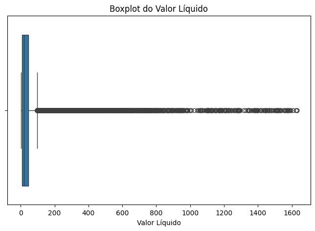
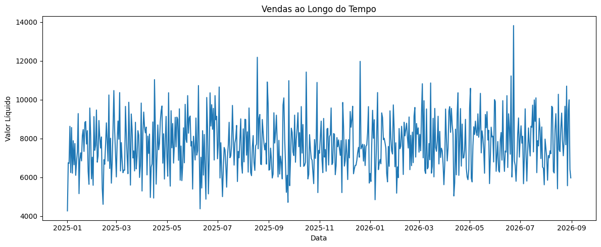
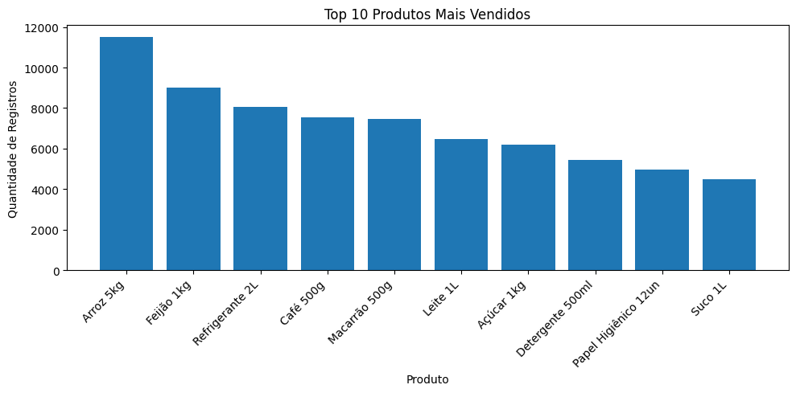
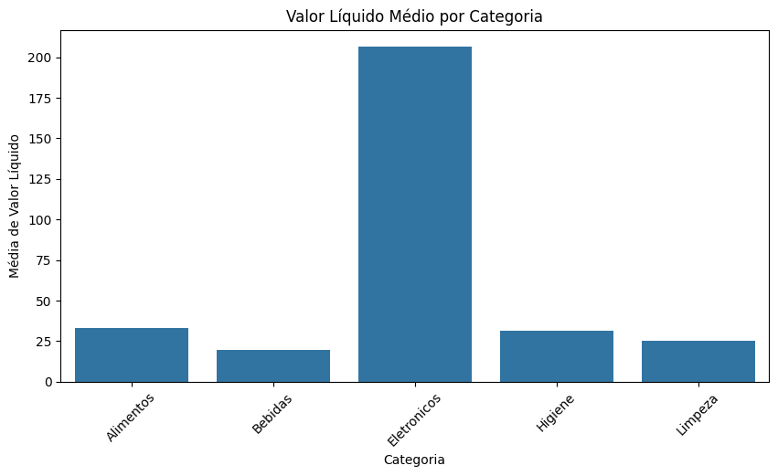
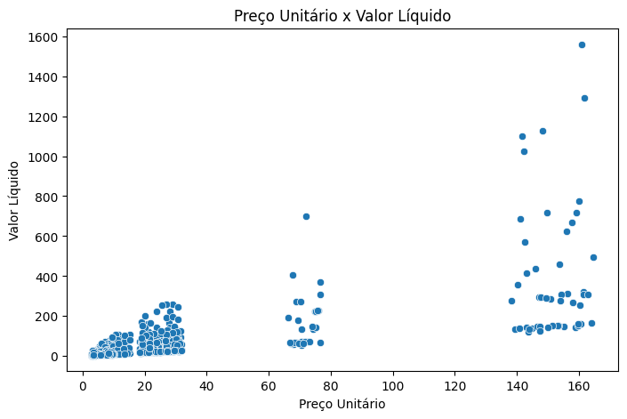

<div align="center">

# 🛒 Supermercado ABC — Análise Exploratória com Polars

### 100 mil vendas, 8 gráficos e zero Pandas.


[**▶ Abrir no Colab**](https://colab.research.google.com/github/USUARIO/REPO/blob/main/Aula-14-Visualizacao-de-Dados-Polars.ipynb) · [Ver os gráficos](#-galeria) · [Como rodar](#-como-rodar)

<sub>UniCEUB · Aula 14 · Visualização de Dados com Python</sub>

</div>

---

## 🎯 Sobre o projeto

Este repositório é a **versão Polars** do notebook da Aula 14 de Visualização de Dados. O roteiro original usa Pandas; aqui toda a leitura, limpeza e agregação foi reescrita com **Polars**, e os gráficos continuam sendo feitos com **Matplotlib** e **Seaborn**.

O dataset simula as vendas de uma rede de supermercados no Distrito Federal, e o objetivo é praticar **EDA (Análise Exploratória de Dados)**: entender a estrutura, ajustar tipos, calcular indicadores e deixar os gráficos contarem a história.

## 📊 O dataset em números

| | |
|---|---|
| 🧾 **Itens vendidos** | 100.000 |
| 🛍️ **Vendas (cupons)** | 32.995 |
| 👥 **Clientes únicos** | 19.859 |
| 🏬 **Filiais** | 5 |
| 📦 **Produtos distintos** | 18 |
| 💰 **Valor líquido total** | ≈ R$ 4,68 milhões |
| 📅 **Período** | 01/01/2025 → 31/08/2026 |
| 🧹 **Valores nulos** | 0 |

**Colunas (23):** `id_item`, `id_venda`, `data_hora`, `filial_id`, `filial`, `cidade`, `estado`, `caixa`, `operador_caixa`, `id_cliente`, `segmento_cliente`, `produto`, `categoria`, `subcategoria`, `marca`, `quantidade`, `preco_unitario`, `desconto_valor`, `valor_liquido`, `custo_total`, `imposto`, `comissao`, `forma_pagamento`.

## 🔍 O que os dados mostram

- 📱 **Eletrônicos e Alimentos dominam:** juntas, as duas categorias respondem por cerca de **78%** do valor líquido (Eletrônicos ≈ 44%, Alimentos ≈ 34%), mesmo com os eletrônicos vendendo bem menos itens.
- 💳 **Cartão de Crédito lidera** as formas de pagamento (≈ 34% do valor), seguido pelo **PIX** (≈ 27%).
- 🍚 **Arroz 5kg** é o produto mais frequente, com 11.512 registros, seguido de Feijão 1kg e Refrigerante 2L.
- 📈 O valor líquido é **muito assimétrico**: a maioria dos itens é barata e uns poucos itens de ticket alto (eletrônicos) puxam a cauda, como o histograma e o boxplot deixam claro.

## 🖼️ Galeria

<table>
  <tr>
    <td align="center"><b>Vendas por categoria</b><br></td>
    <td align="center"><b>Vendas por forma de pagamento</b><br></td>
  </tr>
  <tr>
    <td align="center"><b>Distribuição do valor líquido</b><br></td>
    <td align="center"><b>Boxplot do valor líquido</b><br></td>
  </tr>
  <tr>
    <td colspan="2" align="center"><b>Vendas ao longo do tempo</b><br></td>
  </tr>
  <tr>
    <td align="center"><b>Top 10 produtos mais vendidos</b><br></td>
    <td align="center"><b>Valor líquido médio por categoria</b><br></td>
  </tr>
  <tr>
    <td colspan="2" align="center"><b>Preço unitário × valor líquido (amostra de 1.000)</b><br></td>
  </tr>
</table>

## 🚀 Como rodar

### Opção 1: Google Colab (zero instalação)

1. Clique em **▶ Abrir no Colab** lá no topo.
2. Execute as células na ordem.
3. Quando a célula de leitura pedir, selecione o `supermercado_abc_100k_variado.csv`.

### Opção 2: Localmente

```bash
# 1. Clone o repositório
git clone https://github.com/USUARIO/REPO.git
cd REPO

# 2. (opcional) crie um ambiente virtual
python -m venv .venv
source .venv/bin/activate      # Windows: .venv\Scripts\activate

# 3. Instale as dependências
pip install -r requirements.txt

# 4. Abra o notebook
jupyter notebook Aula-14-Visualizacao-de-Dados-Polars.ipynb
```

> 💡 Coloque o arquivo `supermercado_abc_100k_variado.csv` na mesma pasta do notebook.

## 🗺️ Roteiro do notebook

| # | Etapa | O que acontece |
|---|---|---|
| 1 | Leitura | `pl.read_csv` carrega as 100 mil linhas |
| 2 | Estrutura | `shape`, `columns`, `schema` e `null_count()` |
| 3 | Tipos | `with_columns` converte datas e números |
| 4 | Estatísticas | `describe()` nas colunas numéricas |
| 5–6 | Barras | Vendas por categoria e por forma de pagamento |
| 7–8 | Distribuição | Histograma e boxplot (Seaborn) |
| 9–10 | Série temporal | Vendas por dia |
| 11 | Ranking | Top 10 produtos |
| 12 | Média | Valor líquido médio por categoria |
| 13 | Correlação | Dispersão preço × valor líquido |

## 🔄 Pandas → Polars (cola rápida)

| Pandas | Polars |
|---|---|
| `pd.read_csv(...)` | `pl.read_csv(...)` |
| `df.info()` | `df.schema` / `df.null_count()` |
| `pd.to_datetime(df["col"])` | `pl.col("col").str.to_datetime()` |
| `df["x"] = ...` | `df.with_columns(...)` |
| `df.groupby("c")["v"].sum()` | `df.group_by("c").agg(pl.col("v").sum())` |
| `s.value_counts()` | `s.value_counts(sort=True)` |
| `df.sample(n, random_state=42)` | `df.sample(n, seed=42)` |
| `df.plot(...)` | ❌ não existe, use Matplotlib/Seaborn |

### ⚠️ Pegadinhas que o notebook já resolve

- **`group_by` não ordena.** Sem `.sort(...)`, a linha do tempo sai embaralhada.
- **Polars não tem `.plot()` nativo.** As colunas vão para o Matplotlib/Seaborn via `.to_numpy()` ou `.to_list()`.
- **`strict=False`** nas conversões equivale ao `errors="coerce"` do Pandas: o que não converte vira `null`.

## 📁 Estrutura do repositório

```
.
├── Aula-14-Visualizacao-de-Dados-Polars.ipynb   # notebook principal
├── supermercado_abc_100k_variado.csv            # dataset
├── requirements.txt                             # dependências
├── images/                                      # gráficos usados no README
└── README.md
```

## 🛠️ Tecnologias

- **[Polars](https://pola.rs/)**: leitura, transformação e agregação dos dados
- **[Matplotlib](https://matplotlib.org/)**: gráficos de barras e linha
- **[Seaborn](https://seaborn.pydata.org/)**: histograma, boxplot, barplot e dispersão
- **[Jupyter](https://jupyter.org/) / [Google Colab](https://colab.research.google.com/)**: ambiente de execução

## 🔭 Próximos passos

- [ ] Margem de lucro por categoria (`valor_liquido - custo_total`)
- [ ] Ranking de filiais e de operadores de caixa
- [ ] Sazonalidade: vendas por mês, dia da semana e hora
- [ ] Comparar segmentos de cliente (Fidelidade × Premium × ...)
- [ ] Migrar para `scan_csv` + `LazyFrame` e medir o ganho de desempenho
- [ ] Gráficos interativos com Plotly

## 📚 Créditos

Notebook original: **Aula 14: Visualização de Dados com Python, UniCEUB**. Esta versão adapta o roteiro para Polars e adiciona checagem de nulos, ordenação explícita nas agregações e a tabela de equivalência com Pandas.

---

<div align="center">

Feito com ☕, 🐍 e ⚡ Polars

⭐ Se ajudou, deixa uma estrela no repo!

</div>
